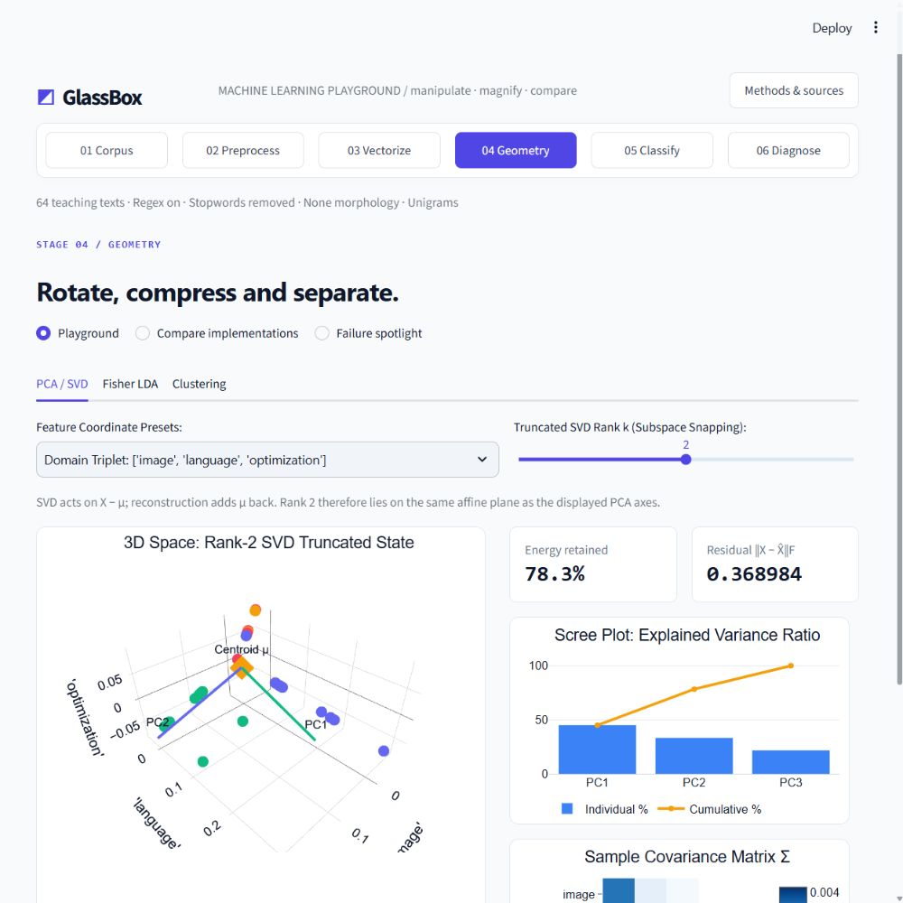
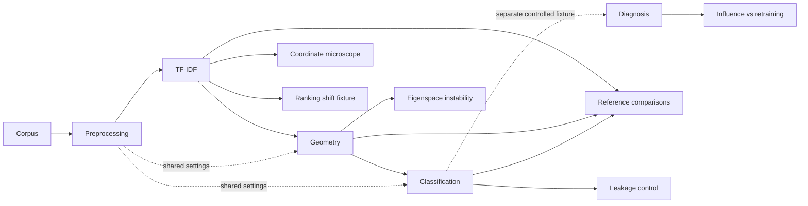

# GlassBox

## Manipulate the model. Magnify the mathematics.

**An interactive machine-learning playground, from raw text to model diagnosis.**

Follow scientific text through preprocessing, TF-IDF, geometric reduction, classification and attribution. Move a control and watch the result change. Magnify a coordinate to substitute real values into an equation. Compare a scratch implementation with a library reference on matched inputs.

Puzzles live inside the pipeline as optional failure spotlights. There are no mandatory answers, locked charts or quiz gates.

**Final handover:** [Run, verify and demonstrate GlassBox](docs/HANDOVER.md) · [Scientific audit](docs/RELEASE_NOTES.md) · [Test results](docs/validation-results.xml)



```powershell
python -m pip install -r glassbox/requirements.txt
python -m streamlit run glassbox/app.py
```

Run from the repository root with Python 3.10+. No account, API key or dataset download is required. `run_app.ps1` and `run_app.bat` are Windows launchers.

The final local validation used Python 3.12.10 and passed **89 tests**. For the tested direct dependency versions, install `requirements-tested.txt` in a Python 3.12 virtual environment. This snapshot is not a full transitive lock.

### One pipeline, several ways to look

| Stage | Playground | Magnify / compare | Failure spotlight |
| :--- | :--- | :--- | :--- |
| **1. Corpus** | Browse all 64 records; highlight a selected paper in the length distribution | Inspect text, metadata and corpus scope | |
| **2. Preprocess** | Toggle cleaning, stopword removal and morphology | Living text differences, stem/lemma comparison and vocabulary contraction | |
| **3. Vectorize** | Counts, TF-IDF, bigrams and a document-term heatmap | Select a cell; inspect substituted equations and code; compare against scikit-learn | The paper that fell without changing |
| **4. Geometry** | Centered PCA/SVD rank-k, Fisher LDA, K-means and HAC | Covariance/scatter matrices; PCA residuals and matched-start K-means comparison | The rotating answer |
| **5. Classify** | SVM, tree splits, KNN, Bayes and neural activations | Separate evaluation view; scratch/reference KNN and multinomial Bayes comparisons | The suspiciously good classifier |
| **6. Diagnose** | Inspect influence and remove a training example | Compare predicted and measured loss changes under the same logistic model | The explanation on trial |

The six stages remain visible in a top navigation strip. Preprocessing and n-gram choices persist and feed the main vectorization, geometry and classifier pipeline. Downstream geometry uses normalized TF-IDF; count and unnormalized views expose intermediate quantities. Training-only fits remain training-only when preprocessing settings change.

Failure spotlights have explicitly controlled fixtures and protocols, separate from the main pipeline settings. This isolates the failure mechanism. Their charts and metrics update immediately. Optional thought prompts never block exploration. Downloadable JSON records capture the currently rendered setup, results, source fingerprint and dependency versions.

### Four optional puzzles

- **The paper that fell without changing:** independently refresh IDF and admit candidates; inspect a fixed document's rank and per-term score contributions.
- **The suspiciously good classifier:** compare honest and leaked representations on the same split, including a random-label control. Leakage need not improve every individual split.
- **The explanation on trial:** compare an influence approximation with a real deletion and retraining. Inspect the effect of leave-one-out normalization.
- **The rotating answer:** compare principal-axis rotation with movement of the retained plane. The display reports actual angles, without promising an arbitrary 90-degree effect.

### Why the implementation is inspectable

- Smoothed TF-IDF, normalization and cosine contributions expose the numbers behind a ranking.
- The 3D PCA engine implements symmetric Jacobi rotations and geometric projection residuals.
- LDA constructs within-class and between-class scatter matrices, solves a symmetric whitened eigenproblem, and transforms unseen rows using fitted parameters.
- Logistic regression uses damped Newton steps with explicit gradients and Hessians. Influence is checked against finite differences and actual retraining of the same objective.
- The honest text evaluation splits before fitting vocabulary, IDF or LDA. Its metrics are separated from training performance.
- Tests cover scientific invariants and counterexamples, not just array shapes. Streamlit AppTest exercises navigation, live controls, pipeline navigation and persistent configuration.

### Architecture



```text
glassbox/
  app.py                    Six-stage navigation and implementation notes
  core/experiments.py       UI-independent reproducible experiments
  core/vectorizer.py        Counts, smoothed IDF and normalization
  core/retrieval.py         Ranking and per-term score contributions
  core/geometry.py          Jacobi eigensolver, PCA and SVD reconstruction
  core/classifiers.py       LDA fit/transform and SVM reference wrapper
  modules/investigations.py Live failure spotlights within pipeline stages
  modules/stage*.py         Interactive stage renderers
  utils/math_engine.py      Logistic influence and other teaching arithmetic
  utils/design.py           Live experiment state, chart theme and record export
  utils/theme.css           Modern light theme and responsive pipeline navigation
  tests/                    Numerical and interaction checks
```

### What is written here, and what comes from a library

| Area | Project implementation | Library boundary |
| :--- | :--- | :--- |
| Text geometry | Counts, DF, smoothed IDF, L2 normalization, cosine attribution | NumPy arithmetic |
| PCA | Covariance, symmetric Jacobi solver, projection and residuals | NumPy array operations |
| LDA | Scatter matrices, whitening construction, fit/transform | NumPy `eigh` |
| Influence | Damped Newton optimizer, logistic gradients/Hessian, influence and deletion comparison | NumPy linear solves |
| Classifier lessons | KNN distances/votes, multinomial Bayes, split impurity, MLP forward/backprop, confusion metrics | NumPy arithmetic |
| Clustering | K-means updates, trajectories, inertia and silhouette arithmetic | SciPy for HAC linkage |
| Reference estimators | Interpretable views and controlled experiments | scikit-learn SVM and decision trees |
| SVD | Rank-k reconstruction, residual and energy accounting | NumPy SVD decomposition |
| Morphology | Offline fallback rules and backend reporting | Optional NLTK Porter / WordNet resources |

“First principles” describes the inspectable implementations above. It does not mean every decomposition, estimator, or linguistic algorithm is implemented from scratch.

### Scientific scope

**Data provenance.** The retrieval fixture contains ten explicitly synthetic abstracts. The PCA puzzle is a constructed covariance experiment. The leakage control uses generated noise and independent random labels. The 64-paper corpus contains curated teaching texts linked to paper metadata; source abstracts and bibliographic records have not been comprehensively verified. Domain labels are teaching assignments. Do not describe it as a scraped, authoritative arXiv benchmark.

**Evaluation.** The leakage puzzle uses paired 70/30 stratified splits. The noise control isolates LDA leakage; the paper mode includes vocabulary/IDF leakage in the deliberately leaked protocol. Interactive exploration uses validation data. A separate untouched test set would be needed for a final performance claim. Leakage need not improve a particular split's score.

**Attribution.** MRI holds out the inspected paper before fitting TF-IDF, uses the fixed `image` and `language` coordinates scaled by 10, and freezes that representation during removal. All classifier fits use mean logistic loss with an L2 penalty on weights and intercept. The classical `-I/n` prediction and ordinary leave-one-out retraining use different data-loss normalization. The derivation drawer exposes that difference and a corrected first-order approximation. Neither approximation guarantees the sign of a finite removal.

**Geometry.** The rotation experiment nearly ties the first two eigenvalues while separating them from the third. A small cross-plane perturbation allows the plane to move too. It compares axes modulo sign and planes through their orthogonal projectors.

**Clustering.** The default coordinates are label-free PCA. Selecting LDA explicitly introduces domain labels into the representation. A measured silhouette peak is not proof of a true domain count. Scratch K-means retains empty centers; scikit-learn may relocate them. The live comparison uses shared initial centers and exposes discrepancies rather than hiding them.

**Verification.** Numerical tolerances are scoped to individual tests. Passing selected checks does not prove all algorithms equivalent to reference libraries, nor guarantee machine precision on arbitrary inputs.

### Validate locally

```powershell
python -m pytest glassbox/tests -q
```

The test suite includes finite-difference verification of influence, leakage-isolation tests, covariance realization and eigenpair residuals, ranking contribution reconciliation, and real Streamlit interaction tests. CI runs the suite on Python 3.11 and 3.12. The workflow is provided in this repository; local execution does not imply a hosted CI run has passed.

### Portfolio description

> Built GlassBox, an interactive ML failure laboratory that turns corpus shift, data leakage, influence approximation and eigenspace instability into reproducible experiments. Implemented inspectable NumPy algorithms, validated mathematical invariants and influence derivatives, and designed a reactive pipeline interface with exportable experiment records.

A useful demo follows one text through the pipeline, magnifies a TF-IDF coordinate, compares its implementation, and opens a failure spotlight to challenge an assumption. Explain the implementation boundaries and one limitation without being prompted.

### Foundations

- [Koh & Liang, Understanding Black-box Predictions via Influence Functions (ICML 2017)](https://proceedings.mlr.press/v70/koh17a.html)
- [scikit-learn: common pitfalls and data leakage](https://scikit-learn.org/stable/common_pitfalls.html#data-leakage)
- [TensorFlow Playground](https://playground.tensorflow.org/), an existing interactive ML learning tool. GlassBox emphasizes falsifiable interventions and auditable failure cases.

See [the product and verification notes](docs/PRODUCT_NOTES.md) for the design rationale, remaining limitations, and a suggested demo.
